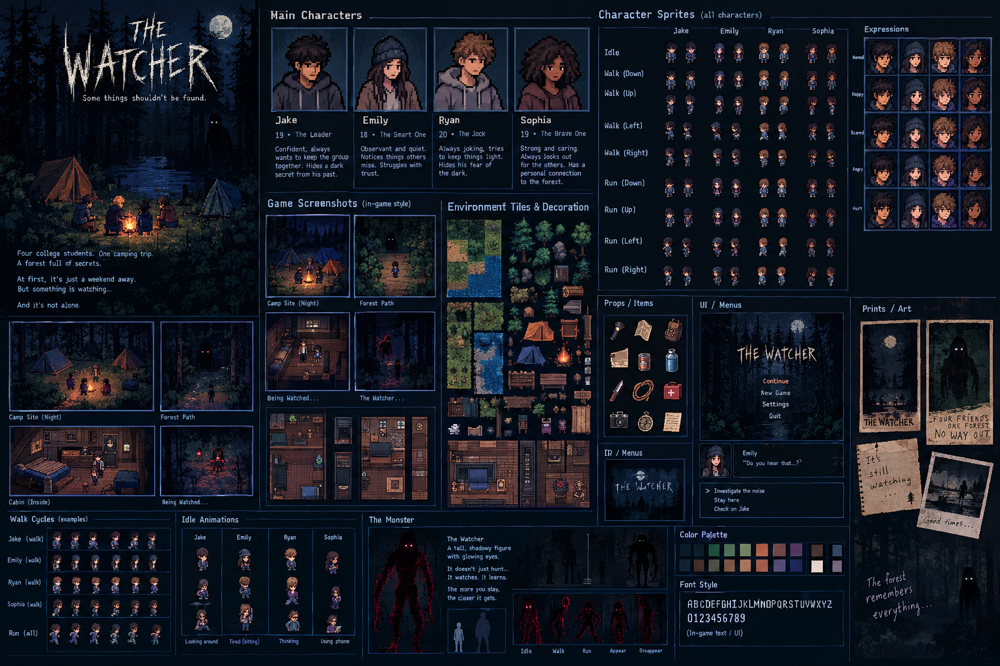

# The Watcher

*Some things shouldn't be found.*

Four college students go camping for a weekend in Blackpine forest. At first, everything is normal. Then they find footprints around their tents, hear someone calling their names from the woods, and realize something has been following them.

**Play it:** https://drexskills.github.io/the-watcher/

## Features
- **Story mode** (6 chapters, auto-saves) and **Chapter mode** (replay any chapter you've reached)
- Walk around scenes with a **touch joystick** on phones, **WASD / arrow keys** or **click-to-walk** on desktop
- Four characters with secrets: Jake, Emily, Ryan and Sophia — including their inner thoughts
- Puzzles: radio tuning, a symbol padlock, hold-your-breath hiding, tap-to-run chases, flashlight exploration
- **6 endings** shaped by your choices, your group's trust, and whether anyone answers when the forest calls
- Procedural music and sound effects, jump scares, and phone vibration (Android)

## Run locally
It's a single file. Open `index.html` in any modern browser.
